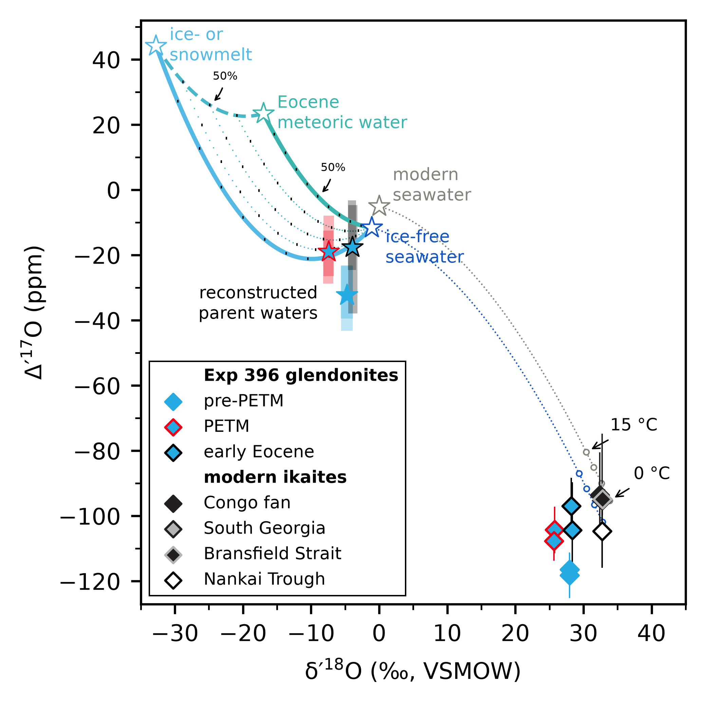

# Supplementary material for "Seasonal Near-Freezing Temperatures in Nordic Region During the Early Eocene Hothouse": Triple Oxygen Isotope Data

## Graphical abstract

## Reference

> [!IMPORTANT]
> Vickers, M. L., Bajnai, D., Bernasconi, S. M., Fiebig, J., Longman, J., Anjana Gireesh, S., Evans, D., Harper, D. T., Jolley, D., Looser, N., Frieling, J., Rickaby, R. E., Pack, A., Pahnke, K., & Jones, M. T. (under review). Seasonal near-freezing temperatures in Nordic region during the early Eocene hothouse.

## Codes

- [1_scale_data_KIEL.py](codes/1_scale_data_KIEL.py) scales and averages the KIEL triple oxygen isotope measurements. Input: [replicate_data_KIEL.csv](data/input/replicate_data_KIEL.csv), [sample_info.csv](data/input/sample_info.csv). Output: [replicate_data_KIEL_scaled.csv](data/exported/csv/replicate_data_KIEL_scaled.csv), [replicate_data_KIEL_averaged.csv](data/exported/csv/replicate_data_KIEL_averaged.csv), [KIEL_replicates_20250527seq.png](figures/png/KIEL_replicates_20250527seq.png), [KIEL_replicates_summary.png](figures/png/KIEL_replicates_summary.png).
- [2_scale_data_OFFLINE.py](codes/2_scale_data_OFFLINE.py) scales and averages the offline triple oxygen isotope measurements. Input: [replicate_data_OFFLINE.csv](data/input/replicate_data_OFFLINE.csv), [sample_info.csv](data/input/sample_info.csv). Output: [replicate_data_OFFLINE_scaled.csv](data/exported/csv/replicate_data_OFFLINE_scaled.csv), [replicate_data_OFFLINE_averaged.csv](data/exported/csv/replicate_data_OFFLINE_averaged.csv), [OFFLINE_replicates.png](figures/png/OFFLINE_replicates.png), [OFFLINE_replicates_summary.png](figures/png/OFFLINE_replicates_summary.png).
- [3_combine_data.py](codes/3_combine_data.py) combines the KIEL and offline carbonate isotope measurements. Input: [replicate_data_KIEL_scaled.csv](data/exported/csv/replicate_data_KIEL_scaled.csv), [replicate_data_OFFLINE_scaled.csv](data/exported/csv/replicate_data_OFFLINE_scaled.csv), [sample_info.csv](data/input/sample_info.csv). Output: [combined_replicate_data.csv](data/exported/csv/combined_replicate_data.csv), [combined_replicates.png](figures/png/combined_replicates.png).
- [4_ikaite_water_equilibrium.py](codes/4_ikaite_water_equilibrium.py) evaluates isotope fractionation between modern ikaite and seawater. Input: [combined_replicate_data.csv](data/exported/csv/combined_replicate_data.csv), the gridded seawater model. Output: [modern_data_with_sw_values.csv](data/exported/csv/modern_data_with_sw_values.csv), [ikaite_water_equilibrium.png](figures/png/ikaite_water_equilibrium.png).
- [5_plot_data.py](codes/5_plot_data.py) reconstructs parent-water compositions for Paleogene glendonites. Input: [combined_replicate_data.csv](data/exported/csv/combined_replicate_data.csv), [modern_seawater.csv](data/literature/modern_seawater.csv), [Aron_2021.csv](data/literature/Aron_2021.csv), [Pang_2015.csv](data/literature/Pang_2015.csv), [Touzeau_2016.csv](data/literature/Touzeau_2016.csv), [Landais_2008_S1.csv](data/literature/Landais_2008_S1.csv), [Landais_2008_S2.csv](data/literature/Landais_2008_S2.csv), [Steen_Larsen_2014.csv](data/literature/Steen_Larsen_2014.csv), [Landais_2012.csv](data/literature/Landais_2012.csv), [Beershaw_2020.csv](data/literature/Beershaw_2020.csv). Output: [all_data.csv](data/exported/csv/all_data.csv), [glendonites.png](figures/png/glendonites.png).
- [waters.py](codes/waters.py) calculates water endmembers from literature isotope measurements. Input: [combined_replicate_data.csv](data/exported/csv/combined_replicate_data.csv), [modern_seawater.csv](data/literature/modern_seawater.csv), [Aron_2021.csv](data/literature/Aron_2021.csv), [Pang_2015.csv](data/literature/Pang_2015.csv), [Touzeau_2016.csv](data/literature/Touzeau_2016.csv), [Landais_2008_S1.csv](data/literature/Landais_2008_S1.csv), [Landais_2008_S2.csv](data/literature/Landais_2008_S2.csv), [Steen_Larsen_2014.csv](data/literature/Steen_Larsen_2014.csv), [Landais_2012.csv](data/literature/Landais_2012.csv), [Beershaw_2020.csv](data/literature/Beershaw_2020.csv). Output: [waters.png](figures/png/waters.png).
- [dual_clumped_plot.py](codes/dual_clumped_plot.py) compares dual clumped isotope measurements with equilibrium values. Input: [dual_clumped_data.csv](data/input/dual_clumped_data.csv). Output: [dual_clumped_plot.png](figures/png/dual_clumped_plot.png).
- [reconstruct_water_Dp17O.py](codes/reconstruct_water_Dp17O.py) calculates parent-water compositions and reconstruction uncertainties. Input: carbonate isotope values, temperatures, and their uncertainties. Output: reconstructed water values and uncertainty bounds returned as a DataFrame.
- [_helper_functions.py](codes/_helper_functions.py) provides shared isotope calculations and table exports.
- [_plot_style.py](codes/_plot_style.py) provides shared figure styling, colors, and figure exports.
- [_water_functions.py](codes/_water_functions.py) provides shared water-endmember calculations and plotting functions.

All figures generated by the scripts have SVG versions available in the [SVG folder](figures/svg/).

## Data files

Data are organized into [input data](data/input/), [exported data](data/exported/), and [literature data](data/literature/).

### Input data files

- [replicate_data_KIEL.csv](data/input/replicate_data_KIEL.csv) contains the raw KIEL triple oxygen isotope measurements. It is used by [1_scale_data_KIEL.py](codes/1_scale_data_KIEL.py).
- [replicate_data_OFFLINE.csv](data/input/replicate_data_OFFLINE.csv) contains the raw offline triple oxygen isotope measurements. It is used by [2_scale_data_OFFLINE.py](codes/2_scale_data_OFFLINE.py).
- [sample_info.csv](data/input/sample_info.csv) contains sampling context and clumped isotope temperatures for modern ikaites and Paleogene glendonites. It is used by [1_scale_data_KIEL.py](codes/1_scale_data_KIEL.py), [2_scale_data_OFFLINE.py](codes/2_scale_data_OFFLINE.py), [3_combine_data.py](codes/3_combine_data.py).
- [dual_clumped_data.csv](data/input/dual_clumped_data.csv) contains dual clumped isotope measurements of modern ikaites and Paleogene glendonites. It is used by [dual_clumped_plot.py](codes/dual_clumped_plot.py).

Additional supplementary data, including the full dual clumped isotope dataset, are available in the manuscript’s Supplementary Information.

### Exported data files

- [replicate_data_KIEL_scaled.csv](data/exported/csv/replicate_data_KIEL_scaled.csv) contains the scaled KIEL replicate measurements. It is exported by [1_scale_data_KIEL.py](codes/1_scale_data_KIEL.py). It is used by [3_combine_data.py](codes/3_combine_data.py).
- [replicate_data_KIEL_averaged.csv](data/exported/csv/replicate_data_KIEL_averaged.csv) contains the averaged KIEL carbonate isotope measurements. It is exported by [1_scale_data_KIEL.py](codes/1_scale_data_KIEL.py).
- [replicate_data_OFFLINE_scaled.csv](data/exported/csv/replicate_data_OFFLINE_scaled.csv) contains the scaled offline replicate measurements. It is exported by [2_scale_data_OFFLINE.py](codes/2_scale_data_OFFLINE.py). It is used by [3_combine_data.py](codes/3_combine_data.py).
- [replicate_data_OFFLINE_averaged.csv](data/exported/csv/replicate_data_OFFLINE_averaged.csv) contains the averaged offline carbonate isotope measurements. It is exported by [2_scale_data_OFFLINE.py](codes/2_scale_data_OFFLINE.py).
- [combined_replicate_data.csv](data/exported/csv/combined_replicate_data.csv) contains the combined carbonate isotope averages for modern ikaites and Paleogene glendonites. It is exported by [3_combine_data.py](codes/3_combine_data.py). It is used by [4_ikaite_water_equilibrium.py](codes/4_ikaite_water_equilibrium.py), [5_plot_data.py](codes/5_plot_data.py), [waters.py](codes/waters.py).
- [modern_data_with_sw_values.csv](data/exported/csv/modern_data_with_sw_values.csv) contains modern ikaite isotope measurements and modeled seawater properties used to evaluate ikaite–water fractionation. It is exported by [4_ikaite_water_equilibrium.py](codes/4_ikaite_water_equilibrium.py).
- [all_data.csv](data/exported/csv/all_data.csv) contains the carbonate isotope measurements and reconstructed parent-water compositions for Paleogene glendonites. It is exported by [5_plot_data.py](codes/5_plot_data.py).

### Literature data used in the scripts

- [Aron_2021.csv](data/literature/Aron_2021.csv) contains triple oxygen isotope measurements of meteoric waters. Source: [Aron et al. (2021)](https://doi.org/10.1016/j.chemgeo.2020.120026).
- [Beershaw_2020.csv](data/literature/Beershaw_2020.csv) contains triple oxygen isotope measurements of meteoric waters across the Pacific Northwest, USA. Source: [Bershaw et al. (2020)](https://doi.org/10.1080/16000889.2020.1773722).
- [Landais_2008_S1.csv](data/literature/Landais_2008_S1.csv) contains triple oxygen isotope measurements of surface snow along an East Antarctic transect. Source: [Landais et al. (2008)](https://doi.org/10.1029/2007GL032096).
- [Landais_2008_S2.csv](data/literature/Landais_2008_S2.csv) contains triple oxygen isotope measurements from the Vostok ice core in Antarctica. Source: [Landais et al. (2008)](https://doi.org/10.1029/2007GL032096).
- [Landais_2012.csv](data/literature/Landais_2012.csv) contains triple oxygen isotope measurements of Greenland firn. Source: [Landais et al. (2012)](https://doi.org/10.1016/j.gca.2011.11.022).
- [Pang_2015.csv](data/literature/Pang_2015.csv) contains triple oxygen isotope measurements of surface snow between Zhongshan Station and Dome A, East Antarctica. Source: [Pang et al. (2015)](https://doi.org/10.1016/j.epsl.2015.01.014).
- [Steen_Larsen_2014.csv](data/literature/Steen_Larsen_2014.csv) contains triple oxygen isotope measurements of surface snow at NEEM, Greenland. Source: [Steen-Larsen et al. (2014)](https://doi.org/10.5194/cp-10-377-2014).
- [Touzeau_2016.csv](data/literature/Touzeau_2016.csv) contains triple oxygen isotope measurements of East Antarctic snow. Source: [Touzeau et al. (2016)](https://doi.org/10.5194/tc-10-837-2016).
- [modern_seawater.csv](data/literature/modern_seawater.csv) contains compiled triple oxygen isotope measurements of modern seawater. Source: [Barkan and Luz (2005)](https://doi.org/10.1002/rcm.2250), [Bershaw et al. (2020)](https://doi.org/10.1080/16000889.2020.1773722), [Lin et al. (2025)](https://doi.org/10.1021/acsearthspacechem.5c00135).

The gridded seawater δ18O and temperature model is excluded from version control because of its size. Download the NetCDF dataset from [Breitkreuz et al. (2018), PANGAEA](https://doi.org/10.1594/PANGAEA.889922) and save it as `data/literature/Breitkreuz_et_al_2018.nc`. Source: [Breitkreuz et al. (2018)](https://doi.org/10.1029/2018JC014300).

## License

All files in this repository are available under CC0 1.0. No rights reserved.
